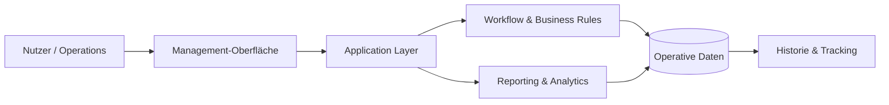

# MES Management Platform

### Operative Workflows, Administration, Tracking und Business-Reporting

<a href="./README.md">English</a> · <a href="./README.de.md"><strong>Deutsch</strong></a> · <a href="./README.tr.md">Türkçe</a>

  
  

---

## Überblick

Die MES Management Platform ist ein operatives Managementsystem für Business-Workflows, Administration, Tracking und Reporting in einer gemeinsamen Umgebung.

Die Plattform macht den operativen Zustand über den gesamten Lebenszyklus eines Geschäftsprozesses sichtbar und steuerbar.

## Kernmodell

## Kernfunktionen

| Bereich | Zweck |
|---|---|
| **Zentrale Operations** | Operative Daten und Workflows in einer Umgebung bündeln |
| **Workflow-Management** | Wiederholbare Prozesse und Zustandsübergänge strukturieren |
| **Tracking** | Operative Aktivitäten sichtbar und nachvollziehbar halten |
| **Administration** | Management- und Verwaltungsprozesse unterstützen |
| **Reporting** | Operative Datensätze in Management-Transparenz umwandeln |
| **Business Rules** | Domänenlogik konsistent abbilden |
| **Historischer Kontext** | Kontext für Analyse und Prüfung bewahren |

## Engineering-Fokus

Die zentrale Engineering-Aufgabe besteht darin, die Konsistenz über verschiedene Workflows hinweg zu bewahren, während das System wächst.

Schwerpunkte:

- Domänen- und Workflow-Modellierung
- Umsetzung von Business Rules
- Operatives State Management
- Datenkonsistenz
- Reporting-Architektur
- Wartbare Modulgrenzen
- Administrative UX
- Historische Nachverfolgung

## Daten & Datenschutz

Das öffentliche Repository enthält keine Produktionszugänge, privaten Unternehmensdaten, internen API-Secrets oder vertrauliche umgebungsspezifische Konfiguration.

---

### Entwickelt von [Taha Kubilay](https://github.com/tahakubilay)

`Enterprise Software` · `Workflow Design` · `Business Logic` · `Reporting` · `Full-Stack Engineering`

