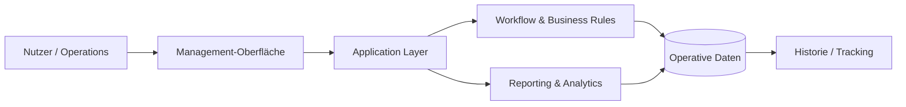

<div align="center">

# MES Management Platform

### End-to-End-Management für Workflows, Administration, Tracking und Reporting


<p><a href="./README.md">English</a> · <a href="./README.de.md"><strong>Deutsch</strong></a> · <a href="./README.tr.md">Türkçe</a></p>

<p>
<a href="https://github.com/tahakubilay"></a>
<a href="https://github.com/tahakubilay/mes-management-platform"></a>


</p>

</div>

---

## ✨ Auf einen Blick

| | |
|---|---|
| 🎯 **Zweck** | Operative Workflows und Business-Administration zentralisieren |
| 🧩 **Fokus** | Workflow-Management, Tracking, Reporting und operative Transparenz |
| 🏢 **Typ** | Enterprise-/Business-Management-Plattform |
| 🧠 **Engineering** | Business Logic, Datenmodellierung, Workflow-Design und Wartbarkeit |
| 🔐 **Öffentliche Version** | Portfolio-sicher; keine Produktionszugänge oder privaten Geschäftsdaten |
| 🚀 **Demo** | Demo mit synthetischen Daten geplant |

> [!NOTE]
> Dieses Repository wird als **öffentliche Engineering-Fallstudie** vorbereitet. Ziel ist zu zeigen, wie das System aufgebaut ist und das operative Problem löst – nicht private Produktionsdaten offenzulegen.

## 🧭 Schnellnavigation

[Überblick](#überblick) · [Kernfunktionen](#kernfunktionen) · [Architektur](#architektur) · [Engineering](#engineering-fokus) · [Demo](#live-demo) · [Roadmap](#portfolio-roadmap)

## 🔎 Überblick

Die MES Management Platform ist ein End-to-End-Managementsystem, das sich an realen operativen Workflows orientiert.

Statt Geschäftsprozesse als isolierte Bildschirme zu behandeln, verbindet die Plattform Administration, Tracking, operativen Zustand und Reporting in einer konsistenten Managementumgebung.

### Die Kernidee

```text
Geschäftsaktivität
      ↓
Operativer Workflow
      ↓
Status & Tracking
      ↓
Management-Transparenz
      ↓
Reporting & Entscheidungen
```

## ⚡ Kernfunktionen

| Bereich | Was dadurch gelöst wird |
|---|---|
| 🗂️ **Zentrale Operations** | Operative Daten und Workflows in einer Umgebung bündeln |
| 🔄 **Workflow-Management** | Wiederholbare Prozesse und Zustandsübergänge strukturieren |
| 📍 **Tracking** | Operative Aktivität sichtbar und nachvollziehbar halten |
| 🧑‍💼 **Administration** | Management- und Administrationsprozesse unterstützen |
| 📊 **Reporting** | Operative Datensätze in Management-Transparenz überführen |
| 🧱 **Business Logic** | Domänenregeln statt manuellen Prozesswissens abbilden |
| 🔐 **Kontrollierter Zugriff** | Rollenorientierte operative Zugriffe unterstützen |
| 🧾 **Historische Transparenz** | Kontext für Reporting, Prüfung und Analyse bewahren |

## 🏗️ Architektur



Die öffentliche Portfolio-Version wird nach der Bereinigung des Quellcodes um reale Modulgrenzen, API-Struktur, Datenbankmodell und Deployment-Topologie erweitert.

## 🧠 Engineering-Fokus

Das Interessante an einer Management-Plattform ist nicht das Erstellen von Formularen, sondern die **Konsistenz über Geschäftsworkflows hinweg** zu bewahren, während das Produkt wächst.

Schwerpunkte:

- Domänen- und Workflow-Modellierung
- Umsetzung von Business Rules
- Operatives State Management
- Datenkonsistenz
- Reporting-Architektur
- Wartbare Modulgrenzen
- Administrative UX
- Historische Nachverfolgung

> [!IMPORTANT]
> Die Portfolio-Version verwendet ausschließlich **synthetische Daten**. Produktionszugänge, interne Firmendaten, API-Secrets und umgebungsspezifische Konfiguration werden nicht veröffentlicht.

## 🎬 Live Demo

**Demo-Umgebung: kommt bald**

Die öffentliche Demo ist als sichere Sandbox für repräsentative Workflows geplant.

Geplante Demo-Inhalte:

- Synthetische Organisationen und Datensätze
- Repräsentative operative Workflows
- Reporting-Ansichten
- Administrative Screens
- Beispielhafte Tracking-Historie

## 🖼️ Produktvorschau

| Dashboard | Workflow | Reporting |
|---|---|---|
| 🖥️ Demnächst | 🔄 Demnächst | 📊 Demnächst |

## 🛣️ Portfolio-Roadmap

- [x] Öffentliches Repository erstellt
- [x] Portfolio-Case-Study-README
- [x] Architekturübersicht
- [ ] Quellcode bereinigen
- [ ] Realen Tech-Stack dokumentieren
- [ ] Screenshots ergänzen
- [ ] Animierten Produkt-Walkthrough ergänzen
- [ ] Datenbank-/Domänenmodell ergänzen
- [ ] Synthetische Demo veröffentlichen
- [ ] Deployment-Architektur ergänzen

## 💡 Warum dieses Projekt wichtig ist

Dieses Projekt repräsentiert Software, deren Wert daraus entsteht zu verstehen, **wie ein Unternehmen tatsächlich arbeitet**, und dieses Wissen in ein wartbares System zu übersetzen.

`Full-Stack Engineering` · `Enterprise Software` · `Workflow Design` · `Business Logic` · `Data Modelling` · `Reporting`

---

<div align="center">

### Entwickelt von [Taha Kubilay](https://github.com/tahakubilay)

</div>