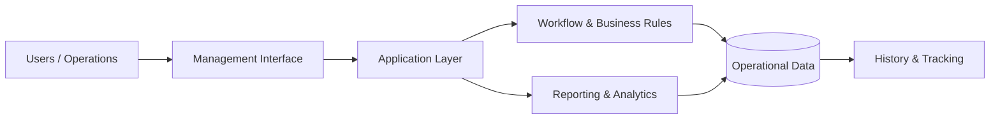

# MES Management Platform

### Operational workflows, administration, tracking and business reporting

<a href="./README.md"><strong>English</strong></a> · <a href="./README.de.md">Deutsch</a> · <a href="./README.tr.md">Türkçe</a>

  
  

---

## Overview

MES Management Platform is an operational management system focused on coordinating business workflows, administrative processes, tracking and reporting in one environment.

The platform is designed to make operational state visible and manageable across the lifecycle of a business process.

## Core Model

## Core Capabilities

| Area | Purpose |
|---|---|
| **Centralized Operations** | Bring operational data and workflows into one environment |
| **Workflow Management** | Structure repeatable processes and state transitions |
| **Tracking** | Keep operational activity visible and traceable |
| **Administration** | Support management and administrative processes |
| **Reporting** | Turn operational records into management visibility |
| **Business Rules** | Represent domain logic consistently |
| **Historical Context** | Preserve context for analysis and review |

## Engineering Focus

The main engineering challenge is maintaining consistency across workflows as the system grows.

Key concerns include:

- Domain and workflow modelling
- Business-rule implementation
- Operational state management
- Data consistency
- Reporting architecture
- Maintainable module boundaries
- Administrative UX
- Historical tracking

## Data & Privacy

The public repository does not expose production credentials, private company records, internal API secrets or environment-specific confidential configuration.

---

### Built by [Taha Kubilay](https://github.com/tahakubilay)

`Enterprise Software` · `Workflow Design` · `Business Logic` · `Reporting` · `Full-Stack Engineering`

