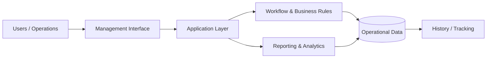

<div align="center">

# MES Management Platform

### End-to-end operational management for workflows, administration, tracking and reporting

<a href="https://github.com/tahakubilay/mes-management-platform">
  
</a>

<br/>

[](https://github.com/tahakubilay)
[](https://github.com/tahakubilay/mes-management-platform)
[](#-project-status)
[](#-live-demo)

<br/>


</div>

---

## ✨ At a Glance

| | |
|---|---|
| 🎯 **Purpose** | Centralize operational workflows and business administration |
| 🧩 **Focus** | Workflow management, tracking, reporting and operational visibility |
| 🏢 **Type** | Enterprise / business management platform |
| 🧠 **Engineering** | Business logic, data modelling, workflow design and maintainability |
| 🔐 **Public Version** | Portfolio-safe; no production credentials or private business data |
| 🚀 **Demo** | Synthetic-data demo planned |

> [!NOTE]
> This repository is being prepared as a **public engineering case study**. The goal is to show how the system is designed and how the operational problem is solved — not to expose private production data.

## 🧭 Quick Navigation

[Overview](#-overview) • [Capabilities](#-core-capabilities) • [Architecture](#-architecture) • [Engineering](#-engineering-focus) • [Demo](#-live-demo) • [Roadmap](#-portfolio-roadmap)

## 🔎 Overview

MES Management Platform is an end-to-end management system built around real operational workflows.

Instead of treating business processes as isolated screens, the platform is designed to connect administration, tracking, operational state and reporting into one coherent management environment.

### The core idea

```text
Business Activity
      ↓
Operational Workflow
      ↓
State & Tracking
      ↓
Management Visibility
      ↓
Reporting & Decisions
```

## ⚡ Core Capabilities

| Area | What it solves |
|---|---|
| 🗂️ **Centralized Operations** | Brings operational data and workflows into one environment |
| 🔄 **Workflow Management** | Structures repeatable business processes and state transitions |
| 📍 **Tracking** | Keeps operational activity visible and traceable |
| 🧑‍💼 **Administration** | Supports management and administrative workflows |
| 📊 **Reporting** | Converts operational records into management visibility |
| 🧱 **Business Logic** | Encodes domain rules instead of relying on manual process knowledge |
| 🔐 **Controlled Access** | Designed with role-oriented operational access in mind |
| 🧾 **Historical Visibility** | Preserves context for reporting, review and operational analysis |

## 🏗️ Architecture



The public portfolio version will expand this with the real module boundaries, API structure, database model and deployment topology once the codebase is sanitized for publication.

## 🧠 Engineering Focus

The interesting part of a management platform is not building forms — it is preserving **consistency across business workflows** as the product grows.

This project highlights work around:

- Domain and workflow modelling
- Business-rule implementation
- Operational state management
- Data consistency
- Reporting architecture
- Maintainable module boundaries
- Administrative UX
- Historical tracking

> [!IMPORTANT]
> The portfolio version will use **synthetic data only**. Production credentials, private company records, API secrets and environment-specific configuration will never be published.

## 🎬 Live Demo

**Demo environment: coming soon**

The public demo is planned as a safe sandbox where recruiters and engineers can explore representative workflows without accessing real operational data.

Planned demo content:

- Synthetic organizations and records
- Representative operational workflows
- Reporting views
- Administrative screens
- Example tracking history

When the demo is deployed, this section and the badge at the top will link directly to it.

## 🖼️ Product Showcase

Real screenshots and a product walkthrough GIF will be added here as the public build is prepared.

| Dashboard | Workflow | Reporting |
|---|---|---|
| 🖥️ Coming soon | 🔄 Coming soon | 📊 Coming soon |

## 🛣️ Portfolio Roadmap

- [x] Public repository created
- [x] Portfolio case-study README
- [x] Architecture overview
- [ ] Sanitize source code
- [ ] Document real technology stack
- [ ] Add screenshots
- [ ] Add animated product walkthrough
- [ ] Add database / domain model
- [ ] Publish synthetic demo
- [ ] Add deployment architecture

## 💡 Why This Project Matters

This project represents the kind of software where value comes from understanding **how a business actually operates** and turning that knowledge into a maintainable system.

It demonstrates experience across:

`Full-Stack Engineering` · `Enterprise Software` · `Workflow Design` · `Business Logic` · `Data Modelling` · `Reporting`

---

<div align="center">

### Built by [Taha Kubilay](https://github.com/tahakubilay)

**Software Engineer · Full-Stack Systems · Enterprise Software · AI & Automation**

[⬆ Back to top](#mes-management-platform)

</div>