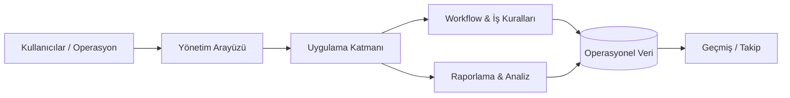

<div align="center">

# MES Yönetim Platformu

### Workflow, yönetim, takip ve raporlama için uçtan uca operasyon platformu


<p><a href="./README.md">English</a> · <a href="./README.de.md">Deutsch</a> · <a href="./README.tr.md"><strong>Türkçe</strong></a></p>

<p>
<a href="https://github.com/tahakubilay"></a>
<a href="https://github.com/tahakubilay/mes-management-platform"></a>


</p>

</div>

---

## ✨ Kısaca

| | |
|---|---|
| 🎯 **Amaç** | Operasyonel workflow'ları ve iş yönetimini merkezileştirmek |
| 🧩 **Odak** | Workflow yönetimi, takip, raporlama ve operasyonel görünürlük |
| 🏢 **Tür** | Enterprise / iş yönetim platformu |
| 🧠 **Mühendislik** | İş mantığı, veri modelleme, workflow tasarımı ve sürdürülebilirlik |
| 🔐 **Public Sürüm** | Portföye güvenli; production kimlik bilgileri ve özel iş verileri yok |
| 🚀 **Demo** | Sentetik verili demo planlanıyor |

> [!NOTE]
> Bu repo **public bir mühendislik case study** olarak hazırlanıyor. Amaç sistemin nasıl tasarlandığını ve operasyonel problemi nasıl çözdüğünü göstermek; özel production verilerini yayınlamak değil.

## 🧭 Hızlı Gezinme

[Genel Bakış](#genel-bakış) · [Temel Yetenekler](#temel-yetenekler) · [Mimari](#mimari) · [Mühendislik](#mühendislik-odağı) · [Demo](#canlı-demo) · [Yol Haritası](#portföy-yol-haritası)

## 🔎 Genel Bakış

MES Yönetim Platformu gerçek operasyonel workflow'lar etrafında geliştirilmiş uçtan uca bir yönetim sistemidir.

İş süreçlerini birbirinden kopuk ekranlar olarak ele almak yerine yönetim, takip, operasyon durumu ve raporlamayı tek bir tutarlı ortamda birleştirmeyi hedefler.

### Temel fikir

```text
İş Aktivitesi
      ↓
Operasyonel Workflow
      ↓
Durum & Takip
      ↓
Yönetim Görünürlüğü
      ↓
Raporlama & Kararlar
```

## ⚡ Temel Yetenekler

| Alan | Çözdüğü ihtiyaç |
|---|---|
| 🗂️ **Merkezi Operasyonlar** | Operasyon verilerini ve workflow'ları tek ortamda toplar |
| 🔄 **Workflow Yönetimi** | Tekrarlanabilir süreçleri ve durum geçişlerini yapılandırır |
| 📍 **Takip** | Operasyonel hareketleri görünür ve izlenebilir tutar |
| 🧑‍💼 **Yönetim** | Yönetim ve idari workflow'ları destekler |
| 📊 **Raporlama** | Operasyon kayıtlarını yönetim görünürlüğüne dönüştürür |
| 🧱 **İş Mantığı** | Manuel süreç bilgisi yerine domain kurallarını sisteme taşır |
| 🔐 **Kontrollü Erişim** | Rol odaklı operasyon erişimini destekler |
| 🧾 **Geçmiş Görünürlüğü** | Raporlama, inceleme ve analiz için bağlamı korur |

## 🏗️ Mimari



Public portföy sürümü, kaynak kod temizliği tamamlandıktan sonra gerçek modül sınırları, API yapısı, veritabanı modeli ve deployment topolojisiyle genişletilecek.

## 🧠 Mühendislik Odağı

Bir yönetim platformundaki zor kısım form üretmek değil, ürün büyürken **iş workflow'ları boyunca tutarlılığı korumaktır**.

Odak alanları:

- Domain ve workflow modelleme
- İş kurallarının uygulanması
- Operasyonel state yönetimi
- Veri tutarlılığı
- Raporlama mimarisi
- Sürdürülebilir modül sınırları
- Yönetim UX'i
- Geçmiş takibi

> [!IMPORTANT]
> Portföy sürümü yalnızca **sentetik veri** kullanacaktır. Production kimlik bilgileri, özel şirket kayıtları, API secret'ları ve ortama özel konfigürasyon yayınlanmayacaktır.

## 🎬 Canlı Demo

**Demo ortamı: yakında**

Public demo, recruiter ve mühendislerin gerçek operasyon verisine erişmeden örnek workflow'ları inceleyebileceği güvenli bir sandbox olarak planlanıyor.

Planlanan demo içeriği:

- Sentetik organizasyonlar ve kayıtlar
- Temsili operasyonel workflow'lar
- Raporlama ekranları
- Yönetim ekranları
- Örnek takip geçmişi

## 🖼️ Ürün Vitrini

| Dashboard | Workflow | Raporlama |
|---|---|---|
| 🖥️ Yakında | 🔄 Yakında | 📊 Yakında |

## 🛣️ Portföy Yol Haritası

- [x] Public repo oluşturuldu
- [x] Portföy case-study README
- [x] Mimari özet
- [ ] Kaynak kodu temizle
- [ ] Gerçek teknoloji yığınını belgele
- [ ] Ekran görüntülerini ekle
- [ ] Animasyonlu ürün walkthrough ekle
- [ ] Veritabanı / domain modelini ekle
- [ ] Sentetik demoyu yayınla
- [ ] Deployment mimarisini ekle

## 💡 Bu Proje Neden Önemli?

Bu proje, değerin **bir işletmenin gerçekte nasıl çalıştığını anlamaktan** ve bu bilgiyi sürdürülebilir bir sisteme dönüştürmekten geldiği yazılım türünü temsil eder.

`Full-Stack Engineering` · `Enterprise Software` · `Workflow Design` · `Business Logic` · `Data Modelling` · `Reporting`

---

<div align="center">

### Geliştiren: [Taha Kubilay](https://github.com/tahakubilay)

</div>