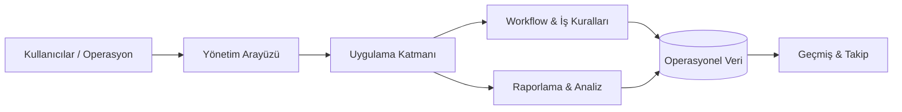

# MES Yönetim Platformu

### Operasyonel workflow, yönetim, takip ve iş raporlaması

<a href="./README.md">English</a> · <a href="./README.de.md">Deutsch</a> · <a href="./README.tr.md"><strong>Türkçe</strong></a>

  
  

---

## Genel Bakış

MES Yönetim Platformu; iş workflow'larını, yönetim süreçlerini, takibi ve raporlamayı tek bir operasyon ortamında birleştiren bir yönetim sistemidir.

Platform, bir iş sürecinin yaşam döngüsü boyunca operasyonel durumun görünür ve yönetilebilir kalmasını hedefler.

## Temel Model

## Temel Yetenekler

| Alan | Amaç |
|---|---|
| **Merkezi Operasyonlar** | Operasyonel veri ve workflow'ları tek ortamda toplamak |
| **Workflow Yönetimi** | Tekrarlanabilir süreçleri ve durum geçişlerini yapılandırmak |
| **Takip** | Operasyonel hareketleri görünür ve izlenebilir tutmak |
| **Yönetim** | Yönetim ve idari süreçleri desteklemek |
| **Raporlama** | Operasyonel kayıtları yönetim görünürlüğüne dönüştürmek |
| **İş Kuralları** | Domain mantığını tutarlı biçimde sisteme taşımak |
| **Geçmiş Bağlamı** | Analiz ve inceleme için bağlamı korumak |

## Mühendislik Odağı

Ana mühendislik problemi, sistem büyürken farklı workflow'lar boyunca tutarlılığı korumaktır.

Başlıca konular:

- Domain ve workflow modelleme
- İş kurallarının uygulanması
- Operasyonel state yönetimi
- Veri tutarlılığı
- Raporlama mimarisi
- Sürdürülebilir modül sınırları
- Yönetim UX'i
- Geçmiş takibi

## Veri & Gizlilik

Public repository production kimlik bilgileri, özel şirket kayıtları, iç API secret'ları veya gizli ortama özel konfigürasyon içermez.

---

### Geliştiren: [Taha Kubilay](https://github.com/tahakubilay)

`Enterprise Software` · `Workflow Design` · `Business Logic` · `Reporting` · `Full-Stack Engineering`

